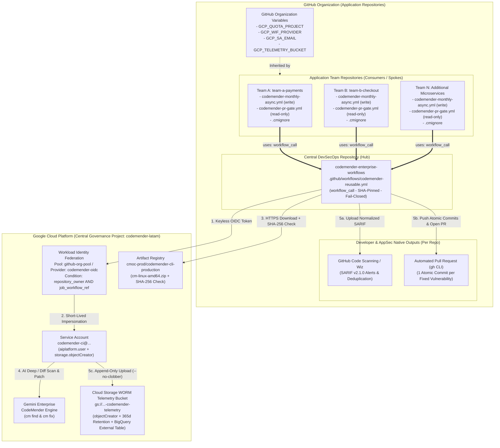
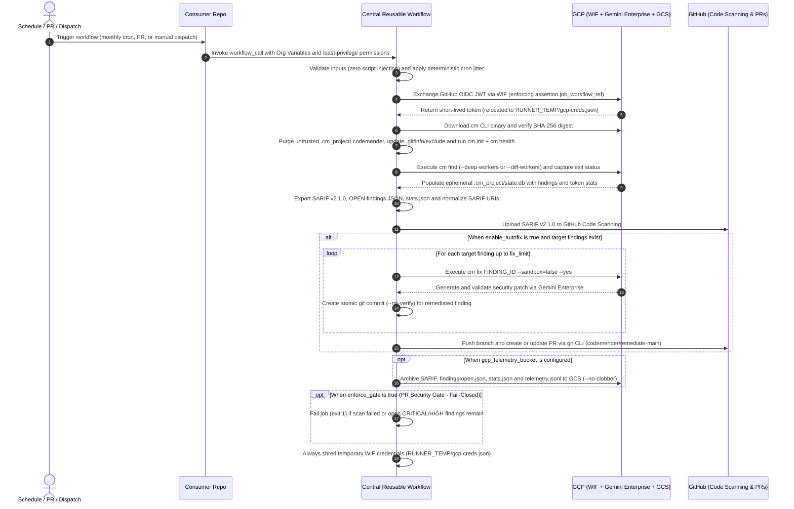

# 🛡️ Google Cloud CodeMender — Enterprise DevSecOps Reference Architecture & Customer Onboarding Guide

**Target Audience:** Enterprise Cloud & Security Architects, DevSecOps Platform Teams, and Application Engineering Leads  
**Architecture Pattern:** Hub-and-Spoke GitHub Actions Reusable Workflow (`workflow_call`) + 100% Stateless Runner + Zero-Trust Keyless GCP WIF (`job_workflow_ref` Bound) + Native SARIF v2.1.0 + Autonomous Remediation PRs + Append-Only FinOps Telemetry  
**Live Reference Repositories:**
- **Central Governance Hub:** [`Cotomacio/codemender-enterprise-workflows`](https://github.com/Cotomacio/codemender-enterprise-workflows)
- **Sample Consumer Repository (Team A — Payments):** [`Cotomacio/team-a-payments`](https://github.com/Cotomacio/team-a-payments)
- **Sample Consumer Repository (Team B — Checkout):** [`Cotomacio/team-b-checkout`](https://github.com/Cotomacio/team-b-checkout)

---

## Executive Summary

When rolling out AI-powered vulnerability detection and autonomous code remediation (**Google Cloud CodeMender CLI — `cm`**) across multiple application repositories in an enterprise organization, copying complex CI/CD scripts into every repository creates governance, security, and maintenance debt.

This guide documents a production-verified **Hub-and-Spoke DevSecOps Reference Architecture** checked against enterprise DevSecOps engineering practices where:
1. **The Central AppSec / Platform Team** maintains a **single reusable workflow repository** (`codemender-enterprise-workflows`) hardened against script injection, tag hijacking, lateral OIDC token minting, and fail-open errors.
2. **Application Teams (Team A, Team B, ... Team N)** onboard in **under 5 minutes** by dropping lightweight, declarative YAML caller files (`~40 lines` with explicit least-privilege `permissions:`) and a `.cmignore` policy into their repository—with **zero secrets, zero JSON service account keys, and zero bash scripts** to maintain.
3. **Every execution is 100% Stateless, Fail-Closed, and Zero-Trust:**
   - **For AppSec & DevSecOps Governance:** Vulnerability lifecycle, deduplication, and triage happen natively via **SARIF v2.1.0** in **GitHub Code Scanning** (or downstream ASPM tools such as **Wiz** or DefectDojo), while immutable telemetry and SARIF artifacts are archived with `--no-clobber` to an append-only Google Cloud Storage bucket (`roles/storage.objectCreator`).
   - **For Application Developers:** CodeMender autonomously generates and validates patches (`cm fix`) powered by **Gemini Enterprise** and uses the official GitHub CLI (`gh pr`) to open a **Pull Request with 1 atomic Git commit per remediated vulnerability** for standard human code review.

> [!IMPORTANT]
> **Why Stateless Runners?**  
> CodeMender maintains a local SQLite database (`.cm_project/state.db`) during execution. Synchronizing a binary SQLite file across concurrent ephemeral CI runners via object storage introduces race conditions and state corruption. By treating every runner as **100% stateless** and exporting **SARIF v2.1.0 + Automated PRs + Append-Only GCS Telemetry** inside the same ephemeral job, this architecture scales horizontally across all repositories in an organization with zero locking or state contention.

---

## 1. End-to-End Architecture Overview

### 1.1 High-Level Hub-and-Spoke Topology



---

### 1.2 Stateless Execution Sequence (Inside a Single Ephemeral Run)



---

## 2. Step-by-Step Implementation Guide

### Step 1: Provision Google Cloud Infrastructure (One-Time Setup)

The Platform / Cloud Security team provisions **one** central Google Cloud project (in our working implementation, `codemender-latam`, Project Number `353807816023`) that acts as the billing, quota, and telemetry hub for all repositories in the GitHub Organization.

#### 1.1 Required Operator Permissions (Pre-Flight Checked Automatically)
Before running [`scripts/setup-enterprise-wif-and-gcs.sh`](https://github.com/Cotomacio/codemender-enterprise-workflows/blob/main/scripts/setup-enterprise-wif-and-gcs.sh), ensure the administrator executing the script holds the following IAM roles on `$PROJECT_ID` (verified by the script's `[0/6]` pre-flight check):
- `roles/serviceusage.serviceUsageAdmin` — Enable Google Cloud APIs.
- `roles/iam.serviceAccountAdmin` — Create the `codemender-ci` Service Account and bind WIF impersonation policy.
- `roles/iam.workloadIdentityPoolAdmin` — Create and configure the Workload Identity Pool and OIDC Provider.
- `roles/resourcemanager.projectIamAdmin` — Grant project-level IAM roles to the Service Account.
- `roles/storage.admin` — Create the WORM GCS telemetry bucket and bind bucket-level `roles/storage.objectCreator`.

#### 1.2 Automated Bootstrap Script
Run [`scripts/setup-enterprise-wif-and-gcs.sh`](https://github.com/Cotomacio/codemender-enterprise-workflows/blob/main/scripts/setup-enterprise-wif-and-gcs.sh) to automate all 6 provisioning steps:

```bash
export PROJECT_ID="codemender-latam"
export GITHUB_ORG="Cotomacio"
export HUB_REPO="codemender-enterprise-workflows"
export RETENTION_PERIOD="365d"   # 1-year WORM audit retention
./scripts/setup-enterprise-wif-and-gcs.sh
```

#### 1.3 What the Bootstrap Configures Under the Hood

1. **Google Cloud APIs Enabled:**
   - `aiplatform.googleapis.com` (**Gemini Enterprise** models powering CodeMender; the underlying GCP API retains the legacy `aiplatform` identifier for SDK backward compatibility)
   - `iam.googleapis.com`, `iamcredentials.googleapis.com`, `sts.googleapis.com` (Keyless OIDC token exchange)
   - `cloudresourcemanager.googleapis.com`, `storage.googleapis.com` (Project metadata & FinOps telemetry)

2. **Dedicated Least-Privilege Service Account:**
   - **Email:** `codemender-ci@codemender-latam.iam.gserviceaccount.com`
   - **Project IAM Roles:**
     - `roles/aiplatform.user` — Required to invoke CodeMender **Gemini Enterprise** models (uses the `aiplatform` IAM role identifier for backward compatibility).
     - `roles/serviceusage.serviceUsageConsumer` — Required to consume project quota.
   - **Bucket IAM Role (True Append-Only Audit Trail):**
     - `roles/storage.objectCreator` on `gs://codemender-latam-codemender-telemetry` — Permits **only** `storage.objects.create`. Runners **cannot** read other repositories' SARIF reports, list bucket contents, or overwrite/delete historical audit records (`storage.objects.delete` is denied).

3. **Zero-Trust Workload Identity Federation (WIF) Bound to the Central Workflow:**
   - **Workload Identity Pool:** `github-org-pool`
   - **OIDC Provider:** `codemender-oidc`
   - **Issuer URI:** `https://token.actions.githubusercontent.com`
   - **Attribute Mapping:**
     ```text
     google.subject=assertion.sub
     attribute.repository=assertion.repository
     attribute.repository_owner=assertion.repository_owner
     attribute.job_workflow_ref=assertion.job_workflow_ref
     ```
   - **Zero-Trust Attribute Condition (`repository_owner` + `job_workflow_ref`):**
     ```cel
     assertion.repository_owner == 'Cotomacio' && assertion.job_workflow_ref.startsWith('Cotomacio/codemender-enterprise-workflows/.github/workflows/codemender-reusable.yml@')
     ```
     > [!CAUTION]
     > **Why `assertion.job_workflow_ref` Binding Is Essential:**  
     > If a WIF provider only checks `assertion.repository_owner == 'ORG'`, any developer with branch write access in any repository could create a custom `.github/workflows/custom.yml` that calls `google-github-actions/auth` directly and impersonates `codemender-ci` outside the governance of the central pipeline. By enforcing `assertion.job_workflow_ref.startsWith(...)` inside Google Cloud STS, **only jobs executing the central reusable workflow** can obtain a GCP access token.

   > [!NOTE]
   > **Enterprise GCP Organization Policy Tip (`constraints/iam.workloadIdentityPoolProviders`):**  
   > In GCP Organizations where `constraints/iam.workloadIdentityPoolProviders` restricts allowed OIDC issuers, ensure the policy allow-lists `is:https://token.actions.githubusercontent.com` (including the `is:` prefix required by GCP Org Policy syntax).

4. **Hardened WORM FinOps & Security Telemetry Bucket:**
   - **Bucket URI:** `gs://codemender-latam-codemender-telemetry`
   - **Controls Enforced:**
     - `--uniform-bucket-level-access` (disables legacy per-object ACLs)
     - `--public-access-prevention` (blocks accidental public exposure at the bucket level)
     - `--retention-period=365d` (WORM retention policy preventing deletion or modification of archived SARIF and token telemetry prior to retention expiry)
     - Optional `--default-encryption-key=${KMS_KEY_NAME}` for Customer-Managed Encryption Keys (**Cloud KMS CMEK**)

---

### Step 2: Create the Central DevSecOps Repository (`codemender-enterprise-workflows`)

The Platform / AppSec team hosts the reusable workflow and onboarding templates in a single central repository:  
🔗 **[`https://github.com/Cotomacio/codemender-enterprise-workflows`](https://github.com/Cotomacio/codemender-enterprise-workflows)**

#### 2.1 Repository File Layout

```text
codemender-enterprise-workflows/
├── .github/
│   └── workflows/
│       └── codemender-reusable.yml              # Central workflow_call engine (0 external scripts)
├── docs/
│   └── ENTERPRISE_ARCHITECTURE_GUIDE.md         # This customer-shareable architecture & onboarding guide
├── examples/
│   └── caller-repo/
│       ├── .cmignore                            # Token & scope optimization template
│       └── .github/
│           └── workflows/
│               ├── codemender-monthly-async.yml # Template 1: Monthly Deep Audit + Auto-PR (write)
│               └── codemender-pr-gate.yml       # Template 2: Fast PR Diff Security Gate (read-only)
├── scripts/
│   ├── setup-enterprise-wif-and-gcs.sh          # Zero-Trust GCP WIF + WORM GCS bootstrap script
│   └── setup-finops-bigquery.sh                 # BigQuery External Table & FinOps Views bootstrap script
└── README.md
```

#### 2.2 Required GitHub Repository Permission for Cross-Repo Sharing
In the central repository (`codemender-enterprise-workflows`), navigate to:
- **Settings → Actions → General → Access**
- Select **"Accessible from repositories in the '<ORG>' organization"** (or make the central workflow repository public/internal as appropriate for your GitHub Enterprise plan).

---

### Step 3: Configure GitHub Organization Variables

Instead of configuring credentials in individual application repositories, set **4 non-sensitive variables once** at the **GitHub Organization** level (**Organization Settings → Secrets and variables → Actions → Variables → New organization variable**):

| Variable Name | Value in Reference Implementation | Purpose |
| :--- | :--- | :--- |
| `GCP_QUOTA_PROJECT` | `codemender-latam` | GCP Project ID where Gemini Enterprise & CodeMender APIs are enabled |
| `GCP_WIF_PROVIDER` | `projects/353807816023/locations/global/workloadIdentityPools/github-org-pool/providers/codemender-oidc` | Full Workload Identity Provider resource path |
| `GCP_SA_EMAIL` | `codemender-ci@codemender-latam.iam.gserviceaccount.com` | Service Account impersonated via short-lived OIDC token |
| `GCP_TELEMETRY_BUCKET` | `codemender-latam-codemender-telemetry` | Append-only WORM GCS bucket for SARIF & FinOps token archiving |

*(Note: For personal GitHub accounts or pilot testing on individual repositories such as [`Cotomacio/team-a-payments`](https://github.com/Cotomacio/team-a-payments) and [`Cotomacio/team-b-checkout`](https://github.com/Cotomacio/team-b-checkout), these exact 4 variables can also be set at the **Repository Variables** level.)*

---

### Step 4: Deep Dive Into the Central Reusable Workflow ([`codemender-reusable.yml`](https://github.com/Cotomacio/codemender-enterprise-workflows/blob/main/.github/workflows/codemender-reusable.yml))

The central workflow [`.github/workflows/codemender-reusable.yml`](https://github.com/Cotomacio/codemender-enterprise-workflows/blob/main/.github/workflows/codemender-reusable.yml) is **100% self-contained** (`bash` + `jq` + `gh` CLI) and pinned to immutable 40-character commit SHAs for all official actions.

#### 4.1 Configurable Inputs & Secrets (`workflow_call` Interface)

| Input / Secret | Type | Default | Description |
| :--- | :---: | :---: | :--- |
| `gcp_project_id` | `string` (required) | — | GCP Project ID (`vars.GCP_QUOTA_PROJECT`) |
| `gcp_wif_provider` | `string` (required) | — | WIF Provider resource name (`vars.GCP_WIF_PROVIDER`) |
| `gcp_sa_email` | `string` (required) | — | Service Account email (`vars.GCP_SA_EMAIL`) |
| `gcp_telemetry_bucket` | `string` | `''` | Optional WORM GCS bucket name (`vars.GCP_TELEMETRY_BUCKET`) |
| `scan_path` | `string` | `'.'` | Subdirectory to scan (useful for monorepos) |
| `scan_mode` | `string` | `'deep'` | `'deep'` (full audit), `'diff'` (PR delta + 1-hop callers), or `'quick'` |
| `cm_location` | `string` | `'global'` | Gemini Enterprise / CodeMender API location (`global`, `us-central1`, `europe-west1`, etc.) |
| `cm_model` | `string` | `''` | Optional Gemini model override |
| `cm_context` | `string` | `''` | Architectural or threat-model context passed via `-c` to `cm find` |
| `enable_autofix` | `boolean` | `true` | Run `cm fix` and open an automated remediation Pull Request |
| `fix_severities` | `string` | `'CRITICAL,HIGH'` | Severities targeted for auto-remediation and gating |
| `fix_limit` | `string` | `'5'` | Max vulnerabilities to auto-fix per execution (bounds run time & PR size) |
| `deep_workers` | `string` | `'8'` | Concurrent worker threads during `deep` scan (`--deep-workers`) |
| `diff_workers` | `string` | `'16'` | Concurrent worker threads during `diff` scan (`--diff-workers`) |
| `schedule_jitter_max_seconds` | `string` | `'300'` | Deterministic per-repo cron jitter window in seconds (`0` to disable) |
| `enforce_gate` | `boolean` | `false` | Fail the CI job (`exit 1`, **fail-closed**) if scan errors or open target findings remain |
| `upload_sarif` | `boolean` | `true` | Upload normalized SARIF v2.1.0 report to GitHub Code Scanning |
| `cm_version` | `string` | `'stable'` | CodeMender CLI version tag in Artifact Registry |
| `cm_sha256` | `string` | `''` | Optional expected 64-hex SHA-256 digest of `cm-linux-amd64.zip` |
| `secrets.wif_audience` | `secret` | — | Optional custom OIDC audience string if required by the WIF provider |
| `secrets.pr_token` | `secret` | — | Optional GitHub App token or PAT to push remediation branches and trigger downstream required CI checks |

#### 4.2 Critical Engineering Mechanisms Inside [`codemender-reusable.yml`](https://github.com/Cotomacio/codemender-enterprise-workflows/blob/main/.github/workflows/codemender-reusable.yml)

1. **Supply-Chain Pinning & Zero Script Injection ([Lines 180–219](https://github.com/Cotomacio/codemender-enterprise-workflows/blob/main/.github/workflows/codemender-reusable.yml#L180-L219)):**
   - Every official action (`actions/checkout`, `google-github-actions/auth`, `github/codeql-action/upload-sarif`, `actions/upload-artifact`) is pinned to its **immutable 40-character Git commit SHA**.
   - Zero `${{ ... }}` expressions appear inside `run:` shell blocks. All inputs are passed through environment variables (`env:`) and validated against strict regexes (`^(deep|diff|quick)$`, `^[0-9]+$`, `^[a-zA-Z0-9._-]+$`), eliminating CWE-78 script injection.

2. **Deterministic Cron Jitter for Multi-Repository Schedules ([Lines 221–230](https://github.com/Cotomacio/codemender-enterprise-workflows/blob/main/.github/workflows/codemender-reusable.yml#L221-L230)):**
   - When multiple repositories share a monthly cron schedule (`0 6 1-7 * 1`), triggering simultaneously can cause regional or global Gemini Enterprise API quota spikes (`429 Resource Exhausted`).
   - On `schedule` events, the workflow computes a deterministic hash of `$GITHUB_REPOSITORY` (`cksum`) modulo `schedule_jitter_max_seconds` (default `300s`), staggering starts smoothly across the window with zero manual coordination.

3. **WIF Credential Relocation & Post-Run Shredding ([Lines 240–256](https://github.com/Cotomacio/codemender-enterprise-workflows/blob/main/.github/workflows/codemender-reusable.yml#L240-L256), [Lines 649–658](https://github.com/Cotomacio/codemender-enterprise-workflows/blob/main/.github/workflows/codemender-reusable.yml#L649-L658)):**
   - `google-github-actions/auth` writes its short-lived OIDC credential file (`gha-creds-*.json`) directly into `$GITHUB_WORKSPACE`.
   - Because CodeMender runs `git checkout HEAD -- . && git clean -fd` inside `$GITHUB_WORKSPACE` to guarantee a clean worktree before scanning and patching, an unprotected credential file inside the workspace would be deleted mid-run.
   - The workflow relocates the credential file into `$RUNNER_TEMP/gcp-creds.json` (`chmod 600`), adds `.cm_project`, `.exploit`, and `gha-creds-*.json` to `.git/info/exclude`, and shreds the credential file in an `if: ${{ always() }}` final step.

4. **Direct Artifact Registry CLI Download + SHA-256 Integrity Verification ([Lines 258–279](https://github.com/Cotomacio/codemender-enterprise-workflows/blob/main/.github/workflows/codemender-reusable.yml#L258-L279)):**
   - Downloads `cm-linux-amd64.zip` from `https://artifactregistry.googleapis.com/download/v1/projects/cmoc-prod/locations/us/repositories/codemender-cli-production/files/cm%3A${CM_VERSION}%3Acm-linux-amd64.zip:download?alt=media` with automatic network retries (`--retry 3 --retry-delay 2 --retry-all-errors`).
   - Computes and logs the **SHA-256 digest** of both the `.zip` archive and the extracted `cm` binary, and enforces `sha256sum --check --strict` whenever `cm_sha256` is specified.

5. **Untrusted Workspace Sanitization ([Lines 281–297](https://github.com/Cotomacio/codemender-enterprise-workflows/blob/main/.github/workflows/codemender-reusable.yml#L281-L297)):**
   - Purges any pre-existing `.cm_project`, `.exploit`, or `~/.codemender` directories prior to `cm init` so a repository cannot inject pre-seeded CodeMender configuration files.

6. **SARIF v2.1.0 Normalization for GitHub Code Scanning ([Lines 331–359](https://github.com/Cotomacio/codemender-enterprise-workflows/blob/main/.github/workflows/codemender-reusable.yml#L331-L359)):**
   - Normalizes `artifactLocation.uri` via `jq` to strip `${GITHUB_WORKSPACE}/` prefixes and guarantees `region.startLine >= 1`, ensuring GitHub Code Scanning anchors every alert directly onto the exact source file and line in the repository.

7. **Atomic Commits (`--no-verify`) & Native `gh pr` Pull Request Creation ([Lines 408–465](https://github.com/Cotomacio/codemender-enterprise-workflows/blob/main/.github/workflows/codemender-reusable.yml#L408-L465), [Lines 578–630](https://github.com/Cotomacio/codemender-enterprise-workflows/blob/main/.github/workflows/codemender-reusable.yml#L578-L630)):**
   - Iterates through up to `fix_limit` open findings matching `fix_severities` (prioritizing `CRITICAL` over `HIGH` and excluding `[LEGACY / UNTOUCHED]` delta items), sanitizing TSV fields against control-character injection.
   - Runs `cm fix <FINDING_ID> --sandbox=false --yes --bypass-warning < /dev/null`, stages only tracked modifications (`git add -u`), cleans untracked temporary files, and creates a dedicated **atomic commit** with `git commit --no-verify` (preventing untrusted `.git/hooks` from executing):
     ```text
     fix(security): remediate <Finding Title> [<Severity>]
     CodeMender Finding ID: <ID>
     ```
   - Pushes `codemender/remediate-<branch>` and creates or updates the Pull Request using the official pre-installed GitHub CLI (`gh pr create` / `gh pr edit`)—requiring **zero third-party community GitHub Actions**.

8. **Fail-Closed PR Security Gate ([Lines 299–329](https://github.com/Cotomacio/codemender-enterprise-workflows/blob/main/.github/workflows/codemender-reusable.yml#L299-L329), [Lines 632–647](https://github.com/Cotomacio/codemender-enterprise-workflows/blob/main/.github/workflows/codemender-reusable.yml#L632-L647)):**
   - Captures the true exit code of `cm find` via `${PIPESTATUS[0]}` (`scan_exit_code`).
   - When `enforce_gate: true`, the gate fails (`exit 1`) not only when open `CRITICAL`/`HIGH` findings are detected, but also if `scan_exit_code != 0` or `steps.triage.outcome != 'success'`—eliminating CWE-636 fail-open vulnerabilities during quota or network outages.

---

### Step 5: Onboarding an Application Team Repository (`team-a-payments`)

To onboard any application repository—demonstrated live in [`Cotomacio/team-a-payments`](https://github.com/Cotomacio/team-a-payments) and [`Cotomacio/team-b-checkout`](https://github.com/Cotomacio/team-b-checkout)—the application squad adds **3 declarative configuration files** to their repository.

#### 5.1 File 1: `.cmignore` (Scope & Token Optimization)
Placed at the root of the application repository ([`team-a-payments/.cmignore`](https://github.com/Cotomacio/team-a-payments/blob/main/.cmignore)) to exclude unit tests, mocks, generated protobuf/OpenAPI stubs, and internal tooling directories from AI analysis:

```gitignore
# Dependency, VCS & Local Tooling Directories
.git/
.cm_project/
.exploit/
node_modules/
vendor/
target/
build/
dist/
out/
.gradle/
.mvn/
.venv/
venv/
__pycache__/
*.sarif

# Unit / Integration Test Suites & Mock Data
**/test/**
**/tests/**
**/__tests__/**
**/__mocks__/**
**/*Test.java
**/*Tests.java
**/*IT.java
**/*_test.go
**/*_test.py
**/*.spec.ts
**/*.test.ts
**/*.spec.js
**/*.test.js
testdata/
fixtures/

# Generated Code, Protobufs & OpenAPI / Swagger Stubs
**/generated/**
**/gen/**
**/*.pb.go
**/*_pb2.py
**/*_pb2_grpc.py
openapi/
swagger/

# Database Migrations & Static Assets
migrations/
flyway/
liquibase/
public/
static/
assets/
docs/
*.min.js
*.bundle.js
*.map
# Note: Remove `*.sql` below if your repository contains PL/SQL stored procedures or dynamic SQL templates requiring security analysis.
*.sql
*.md
```

#### 5.2 File 2: `.github/workflows/codemender-monthly-async.yml` (Deep Audit + Auto-PR)
Placed in [`.github/workflows/codemender-monthly-async.yml`](https://github.com/Cotomacio/team-a-payments/blob/main/.github/workflows/codemender-monthly-async.yml). Runs asynchronously on the first Monday of each month (with automatic cron jitter) or via manual trigger (`workflow_dispatch`), performing a full `--deep` scan and opening an automated remediation PR:

```yaml
name: CodeMender — Monthly Deep Audit & Autonomous Remediation

on:
  schedule:
    - cron: '0 6 1-7 * 1'   # 06:00 UTC on the first Monday of every month (deterministic jitter applied automatically)
  workflow_dispatch:
    inputs:
      scan_mode:
        description: 'Scan mode override (deep or quick)'
        required: false
        default: 'deep'
        type: choice
        options:
          - deep
          - quick
      enable_autofix:
        description: 'Generate automated remediation PR (cm fix)'
        required: false
        default: true
        type: boolean

jobs:
  security-audit:
    permissions:
      contents: write          # Push remediation branch when enable_autofix is true
      pull-requests: write     # Open/update remediation Pull Request
      id-token: write          # Mint GCP Workload Identity Federation OIDC token
      security-events: write   # Upload SARIF v2.1.0 to GitHub Code Scanning
      actions: read            # Required by github/codeql-action/upload-sarif in private repos
    uses: Cotomacio/codemender-enterprise-workflows/.github/workflows/codemender-reusable.yml@main
    with:
      gcp_project_id: ${{ vars.GCP_QUOTA_PROJECT }}
      gcp_wif_provider: ${{ vars.GCP_WIF_PROVIDER }}
      gcp_sa_email: ${{ vars.GCP_SA_EMAIL }}
      gcp_telemetry_bucket: ${{ vars.GCP_TELEMETRY_BUCKET }}
      scan_mode: ${{ inputs.scan_mode || 'deep' }}
      enable_autofix: ${{ inputs.enable_autofix != false }}
      fix_severities: 'CRITICAL,HIGH'
      fix_limit: '5'
      schedule_jitter_max_seconds: '300'
      enforce_gate: false
      upload_sarif: true
```

#### 5.3 File 3: `.github/workflows/codemender-pr-gate.yml` (Fast PR Diff Gate — Read-Only)
Placed in [`.github/workflows/codemender-pr-gate.yml`](https://github.com/Cotomacio/team-a-payments/blob/main/.github/workflows/codemender-pr-gate.yml). Runs on every Pull Request targeting `main` or `master` with **strict read-only repository permissions (`contents: read`, `pull-requests: read`)**, using `--diff` mode to analyze only modified code and its 1-hop callers/callees and blocking the merge (`enforce_gate: true`, fail-closed) if new `CRITICAL` or `HIGH` vulnerabilities are introduced:

```yaml
name: CodeMender — Pull Request Security Gate (Diff Mode)

on:
  pull_request:
    branches:
      - main
      - master

jobs:
  pr-security-gate:
    permissions:
      contents: read           # Read-only checkout for PR delta scan (no branch write access)
      pull-requests: read      # Read-only PR metadata
      id-token: write          # Mint GCP Workload Identity Federation OIDC token
      security-events: write   # Upload SARIF v2.1.0 annotations to the Pull Request
      actions: read            # Required by github/codeql-action/upload-sarif in private repos
    uses: Cotomacio/codemender-enterprise-workflows/.github/workflows/codemender-reusable.yml@main
    with:
      gcp_project_id: ${{ vars.GCP_QUOTA_PROJECT }}
      gcp_wif_provider: ${{ vars.GCP_WIF_PROVIDER }}
      gcp_sa_email: ${{ vars.GCP_SA_EMAIL }}
      gcp_telemetry_bucket: ${{ vars.GCP_TELEMETRY_BUCKET }}
      scan_mode: 'diff'
      enable_autofix: false
      fix_severities: 'CRITICAL,HIGH'
      enforce_gate: true
      upload_sarif: true
```

---

### Step 6: End-to-End Execution & Multi-Repo FinOps BigQuery Walkthrough (`team-a-payments` & `team-b-checkout`)

To validate the entire architecture end-to-end across multiple application teams, we onboarded two live consumer repositories:
1. **[`Cotomacio/team-a-payments`](https://github.com/Cotomacio/team-a-payments)** ([`app.py`](https://github.com/Cotomacio/team-a-payments/blob/main/app.py)) — Payment Gateway microservice with **2 intentional vulnerabilities**:
   - **SQL Injection (`CWE-89`, High)** in `/payments/lookup`
   - **OS Command Injection (`CWE-78`, High)** in `/payments/export-receipt`
2. **[`Cotomacio/team-b-checkout`](https://github.com/Cotomacio/team-b-checkout)** ([`app.py`](https://github.com/Cotomacio/team-b-checkout/blob/main/app.py)) — E-Commerce Checkout & Fulfilment service with **3 intentional vulnerabilities**:
   - **OS Command Injection (`CWE-78`, Critical)** in `/checkout/shipping-label`
   - **SQL Injection (`CWE-89`, High)** in `/checkout/apply-promo`
   - **Path Traversal (`CWE-22`, High)** in `/checkout/invoice-template`

#### 6.1 Multi-Repo Pipeline Execution Summary
- 🔗 **Team A Live Run (`#40699576701`):** [`https://github.com/Cotomacio/team-a-payments/actions/runs/40699576701`](https://github.com/Cotomacio/team-a-payments/actions/runs/40699576701)
- 🔗 **Team B Live Run (`#40699571878`):** [`https://github.com/Cotomacio/team-b-checkout/actions/runs/40699571878`](https://github.com/Cotomacio/team-b-checkout/actions/runs/40699571878)

| Pipeline Step | Team A (`team-a-payments`) | Team B (`team-b-checkout`) |
| :--- | :---: | :---: |
| `Authenticate to Google Cloud (WIF)` | ✅ Keyless OIDC (`codemender-ci@...`) | ✅ Keyless OIDC (`codemender-ci@...`) |
| `Protect WIF Credentials Outside Git Workspace` | ✅ Isolated in `$RUNNER_TEMP/gcp-creds.json` | ✅ Isolated in `$RUNNER_TEMP/gcp-creds.json` |
| `Download & Install CodeMender CLI` | ✅ Installed `cm` + verified SHA-256 | ✅ Installed `cm` + verified SHA-256 |
| `Execute CodeMender Scan (cm find)` | ✅ Found **2 HIGH** vulnerabilities (`37s`) | ✅ Found **1 CRITICAL, 2 HIGH** (`2m 12s`) |
| `Upload SARIF v2.1.0 to GitHub Code Scanning` | ✅ Uploaded (`category: codemender-deep`) | ✅ Uploaded (`category: codemender-deep`) |
| `Autonomous Remediation (cm fix -> Atomic Commits)` | ✅ Fixed **2/2** findings (`15m 09s`) | ✅ Fixed **3/3** findings (`27m 07s`) |
| `Export FinOps Telemetry & Archive SARIF to GCS` | ✅ Exported `telemetry.jsonl` & `sarif` (`--no-clobber`) | ✅ Exported `telemetry.jsonl` & `sarif` (`--no-clobber`) |
| `Open Autonomous Remediation Pull Request` | ✅ Opened [PR #2](https://github.com/Cotomacio/team-a-payments/pull/2) | ✅ Opened [PR #1](https://github.com/Cotomacio/team-b-checkout/pull/1) |

#### 6.2 Output 1: Native GitHub Code Scanning Alerts (SARIF v2.1.0)
Both repositories display their vulnerabilities natively in **Security → Code scanning**:
- **Team A (`team-a-payments`):** [Alert #1 (`CWE-78`)](https://github.com/Cotomacio/team-a-payments/security/code-scanning/1) & [Alert #2 (`CWE-89`)](https://github.com/Cotomacio/team-a-payments/security/code-scanning/2)
- **Team B (`team-b-checkout`):** [Code Scanning Alerts (`CWE-78`, `CWE-89`, `CWE-22`)](https://github.com/Cotomacio/team-b-checkout/security/code-scanning)

#### 6.3 Output 2: Automated Remediation Pull Requests with Atomic Commits
- **Team A ([PR #2](https://github.com/Cotomacio/team-a-payments/pull/2) / [PR #1](https://github.com/Cotomacio/team-a-payments/pull/1)):** Remediated SQL Injection (`CWE-89`) with parameterized SQL queries and OS Command Injection (`CWE-78`) by eliminating `shell=True` and enforcing strict regex validation.
- **Team B ([PR #1](https://github.com/Cotomacio/team-b-checkout/pull/1)):** Remediated all 3 vulnerabilities in 3 isolated atomic commits (`21d180bb` for OS Command Injection, `ec4994fd` for SQL Injection, and `5f12c6a6` for Path Traversal).

#### 6.4 Output 3: Centralized FinOps Telemetry in GCS & BigQuery External Table Analytics
After `cm fix` completes, the reusable workflow refreshes `cm stats --json` so both `find` and `fix` token buckets are captured, enriches the payload with GitHub repository/run metadata, and writes a single-line **Newline-Delimited JSON (`codemender-telemetry.jsonl`)** record to two immutable GCS paths using `--no-clobber`:

```text
gs://codemender-latam-codemender-telemetry/
├── codemender-telemetry/                                       # 1. Partitioned Audit Archive (SARIF + Findings + Stats)
│   └── Cotomacio/
│       ├── team-a-payments/2026/10/28/20261028T140308Z-40699576701/
│       │   ├── codemender.sarif
│       │   ├── findings-open.json
│       │   ├── stats.json
│       │   └── telemetry.jsonl
│       └── team-b-checkout/2026/10/28/20261028T141632Z-40699571878/
│           ├── codemender.sarif
│           ├── findings-open.json
│           ├── stats.json
│           └── telemetry.jsonl
└── codemender-finops-jsonl/                                    # 2. Flat NDJSON Prefix for BigQuery External Table
    ├── 20261028T140308Z-40699576701-Cotomacio_team-a-payments.jsonl
    └── 20261028T141632Z-40699571878-Cotomacio_team-b-checkout.jsonl
```

##### Required Operator Permissions & Provisioning (`scripts/setup-finops-bigquery.sh`)
Before running [`scripts/setup-finops-bigquery.sh`](https://github.com/Cotomacio/codemender-enterprise-workflows/blob/main/scripts/setup-finops-bigquery.sh), ensure the operator holds the following IAM roles (verified by the script's `[0/4]` pre-flight check):
- `roles/serviceusage.serviceUsageAdmin` (if `bigquery.googleapis.com` is not yet enabled)
- `roles/bigquery.dataEditor` (or `roles/bigquery.admin`) + `roles/bigquery.jobUser` on `$PROJECT_ID`
- `roles/storage.objectViewer` on `gs://codemender-latam-codemender-telemetry`

Run the provisioning script once to create the `codemender_finops` dataset, the `scan_telemetry` External Table over `gs://codemender-latam-codemender-telemetry/codemender-finops-jsonl/*.jsonl`, and two executive FinOps views:

```bash
./scripts/setup-finops-bigquery.sh codemender-latam codemender-latam-codemender-telemetry codemender_finops
```

##### Live BigQuery Query 1: Executive Multi-Repository FinOps Summary (`v_repository_finops_summary`)
```sql
SELECT
  repository, scan_mode, total_scans,
  total_findings_detected AS detected,
  total_findings_remediated AS remediated,
  total_input_tokens, total_cached_tokens,
  total_output_tokens, total_thought_tokens, total_tokens,
  avg_cache_hit_pct, total_duration_sec, estimated_cost_usd
FROM `codemender-latam.codemender_finops.v_repository_finops_summary`;
```

**Live BigQuery Output (`codemender-latam`):**

| `repository` | `scan_mode` | `total_scans` | `detected` | `remediated` | `total_input_tokens` | `total_cached_tokens` | `total_output_tokens` | `total_thought_tokens` | `total_tokens` | `avg_cache_hit_pct` | `total_duration_sec` | `estimated_cost_usd` |
| :--- | :---: | :---: | :---: | :---: | ---: | ---: | ---: | ---: | ---: | ---: | ---: | ---: |
| `Cotomacio/team-b-checkout` | `deep` | `1` | `3` | `3` | `1,680,613` | `1,237,576` | `5,419` | `50,676` | `1,736,708` | `73.64%` | `1,759.5s` | **`$1.5015`** |
| `Cotomacio/team-a-payments` | `deep` | `1` | `2` | `2` | `907,225` | `653,921` | `4,415` | `16,120` | `927,760` | `72.08%` | `945.9s` | **`$0.7263`** |

##### Live BigQuery Query 2: Command Bucket Breakdown — `find` vs. `fix` (`v_command_bucket_breakdown`)
```sql
SELECT
  repository, command_bucket, requests,
  input_tokens, cached_tokens, output_tokens, thought_tokens,
  total_tokens, cache_hit_pct, duration_formatted
FROM `codemender-latam.codemender_finops.v_command_bucket_breakdown`;
```

**Live BigQuery Output (`codemender-latam`):**

| `repository` | `command_bucket` | `requests` | `input_tokens` | `cached_tokens` | `output_tokens` | `thought_tokens` | `total_tokens` | `cache_hit_pct` | `duration_formatted` |
| :--- | :---: | :---: | ---: | ---: | ---: | ---: | ---: | ---: | :---: |
| `Cotomacio/team-b-checkout` | `fix` | `3` | `1,603,111` | `1,197,237` | `3,847` | `32,076` | `1,639,034` | `74.68%` | `27m 07s` |
| `Cotomacio/team-b-checkout` | `find --deep` | `1` | `77,502` | `40,339` | `1,572` | `18,600` | `97,674` | `52.05%` | `02m 12s` |
| `Cotomacio/team-a-payments` | `fix` | `2` | `887,626` | `650,000` | `3,329` | `13,697` | `904,652` | `73.23%` | `15m 09s` |
| `Cotomacio/team-a-payments` | `find --deep` | `1` | `19,599` | `3,921` | `1,086` | `2,423` | `23,108` | `20.01%` | `00m 37s` |

> [!TIP]
> **FinOps Insight — Over 72% Context Cache Efficiency & Sub-Dollar Remediation:**  
> Across both repositories (`2.66M` total tokens), **Gemini Enterprise** Context Caching served **72.1% to 73.6%** of all input tokens from cache. Full deep-scan detection plus autonomous patch generation and verification cost **`$0.73` total for Team A (`$0.36` per fixed vulnerability)** and **`$1.50` total for Team B (`$0.50` per fixed vulnerability)**. Platform teams can connect **Looker Studio** directly to `codemender-latam.codemender_finops.v_repository_finops_summary` for real-time FinOps chargeback dashboards by repository and business unit.

---

## 3. Enterprise Governance & Security Hardening Reference

This section documents the engineering and security hardening controls built into the reference architecture.

### 3.1 Supply-Chain Hardening: Immutable Workflow Versioning (`@v1.0.0` vs `@main`)

In the demo repositories (`team-a-payments` and `team-b-checkout`), caller workflows reference `@main` for rapid iteration. In **production environments**, Platform teams should publish signed Git tags/releases on `codemender-enterprise-workflows` (e.g., `v1.0.0`) or pin to a 40-character commit SHA:

```yaml
# Recommended for Production Repositories:
uses: Cotomacio/codemender-enterprise-workflows/.github/workflows/codemender-reusable.yml@v1.0.0
```
Additionally, Platform teams can pass `cm_version` (e.g., `'0.16.6'`) and `cm_sha256` (`'<64-char-hex-digest>'`) so every runner cryptographically verifies the exact CodeMender CLI archive before extraction.

---

### 3.2 Data Privacy, Gemini Enterprise Zero Data Retention, Regional Residency & VPC Service Controls

Enterprise organizations frequently require strict guarantees regarding source code confidentiality when invoking cloud AI models:

1. **Google Cloud Data Governance Guarantee:** Under Google Cloud's Enterprise Data Governance terms for **Gemini Enterprise**, customer source code, prompts, and generated patches sent to Gemini models **are never used to train Google foundation models**.
2. **Zero Data Retention & Abuse Monitoring Exemption:** Customers can enable **Zero Data Retention (ZDR)** and opt out of human abuse review caching on their Google Cloud project (`codemender-latam`) so prompts and code context are processed strictly in memory.
3. **Regional Data Residency (`cm_location`):** If organizational data residency policies require regional API endpoints rather than `global`, pass `cm_location: 'us-central1'` or `cm_location: 'europe-west1'` to the reusable workflow and set `BUCKET_LOCATION` to the matching region when running `setup-enterprise-wif-and-gcs.sh`.
4. **VPC Service Controls (VPC-SC) & Self-Hosted Runners:**
   - For organizations enforcing **VPC Service Controls** perimeters around `aiplatform.googleapis.com` (the backward-compatible Gemini Enterprise endpoint) and `storage.googleapis.com`, deploy **GitHub Actions Runner Controller (ARC)** on internal Google Kubernetes Engine (GKE) clusters inside the authorized VPC network.
   - Configure an ingress/egress policy or Private Google Access (`private.googleapis.com`) so all CodeMender traffic remains entirely on Google's private backbone.

---

### 3.3 Untrusted Code Execution Isolation & Ephemeral Runner Hardening

During `cm find` and `cm fix`, CodeMender may invoke build verification or test commands configured in the repository. To prevent untrusted code in a Pull Request from compromising credentials or persisting across runs:
1. **Ephemeral VM Isolation:** Each GitHub-hosted `ubuntu-24.04` job (or ephemeral GKE ARC pod with `gVisor` / Kata Containers isolation) runs in a single-use virtual environment destroyed immediately after the job completes.
2. **Pre-Init Workspace Sanitization:** Before running `cm init`, the reusable workflow executes `rm -rf .cm_project .exploit ~/.codemender` ([Line 285](https://github.com/Cotomacio/codemender-enterprise-workflows/blob/main/.github/workflows/codemender-reusable.yml#L285)), ensuring a repository cannot pre-seed malicious `.cm_project` configurations.
3. **Git Hook Bypass (`--no-verify`):** Atomic commits use `git commit --no-verify` ([Line 453](https://github.com/Cotomacio/codemender-enterprise-workflows/blob/main/.github/workflows/codemender-reusable.yml#L453)) so untrusted scripts inside `.git/hooks/` are never triggered.
4. **Post-Run Credential Shredding:** The final workflow step (`Shred Temporary WIF Credentials`, `if: ${{ always() }}`, [Lines 649–658](https://github.com/Cotomacio/codemender-enterprise-workflows/blob/main/.github/workflows/codemender-reusable.yml#L649-L658)) deletes `$RUNNER_TEMP/gcp-creds.json` and `~/.config/gcloud/application_default_credentials.json`.

---

### 3.4 GitHub Rulesets, Required Status Checks & Signed Commits (`secrets.pr_token`)

In enterprises where `main` is protected by **GitHub Repository Rulesets** requiring status checks (unit tests, SAST) to pass before merging:
- **Known GitHub Actions Platform Behavior:** By default, branches pushed and Pull Requests opened using the built-in `secrets.GITHUB_TOKEN` **do not trigger downstream `on: pull_request` workflows** (a GitHub anti-recursion safeguard).
- **Enterprise Solution Built Into `codemender-reusable.yml`:** The reusable workflow supports an optional `secrets.pr_token` secret ([Lines 144–146](https://github.com/Cotomacio/codemender-enterprise-workflows/blob/main/.github/workflows/codemender-reusable.yml#L144-L146), [Line 581](https://github.com/Cotomacio/codemender-enterprise-workflows/blob/main/.github/workflows/codemender-reusable.yml#L581)). Organizations can pass a **GitHub App Installation Token** (generated via `actions/create-github-app-token` or stored as an Org secret) via `secrets: pr_token: ${{ secrets.CODEMENDER_APP_TOKEN }}`. Pull Requests opened with a GitHub App token automatically trigger all required CI status checks on `codemender/remediate-main`.

---

## 4. Enterprise Rollout Checklist for Customers

- [ ] **1. GCP Project & APIs:** Select or create a dedicated GCP project for CodeMender quota, verify operator IAM permissions, and run [`scripts/setup-enterprise-wif-and-gcs.sh`](https://github.com/Cotomacio/codemender-enterprise-workflows/blob/main/scripts/setup-enterprise-wif-and-gcs.sh) with `ENFORCE_JOB_WORKFLOW_REF=true` and `RETENTION_PERIOD=365d`.
- [ ] **2. Optional BigQuery FinOps Setup:** Run [`scripts/setup-finops-bigquery.sh`](https://github.com/Cotomacio/codemender-enterprise-workflows/blob/main/scripts/setup-finops-bigquery.sh) to provision the `codemender_finops` BigQuery dataset, External Table, and executive FinOps views.
- [ ] **3. Central Workflow Repo:** Fork or copy [`Cotomacio/codemender-enterprise-workflows`](https://github.com/Cotomacio/codemender-enterprise-workflows) into your GitHub Organization, tag an immutable release (`v1.0.0`), and enable **Actions → Access → Accessible from repositories in the organization**.
- [ ] **4. Organization Variables:** Configure `GCP_QUOTA_PROJECT`, `GCP_WIF_PROVIDER`, `GCP_SA_EMAIL`, and `GCP_TELEMETRY_BUCKET` in GitHub Organization Variables.
- [ ] **5. Pilot Onboarding:** Copy [`.cmignore`](https://github.com/Cotomacio/codemender-enterprise-workflows/blob/main/examples/caller-repo/.cmignore), [`codemender-monthly-async.yml`](https://github.com/Cotomacio/codemender-enterprise-workflows/blob/main/examples/caller-repo/.github/workflows/codemender-monthly-async.yml), and [`codemender-pr-gate.yml`](https://github.com/Cotomacio/codemender-enterprise-workflows/blob/main/examples/caller-repo/.github/workflows/codemender-pr-gate.yml) into pilot repositories (such as [`Cotomacio/team-a-payments`](https://github.com/Cotomacio/team-a-payments) and [`Cotomacio/team-b-checkout`](https://github.com/Cotomacio/team-b-checkout)) and trigger a `workflow_dispatch` run.
- [ ] **6. Organization-Wide Rollout:** Roll out the 3 template files across your organization's application repositories via an automated onboarding PR or GitHub repository template.
