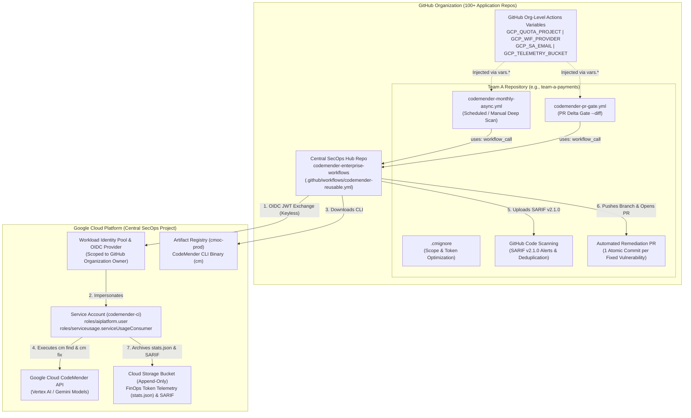
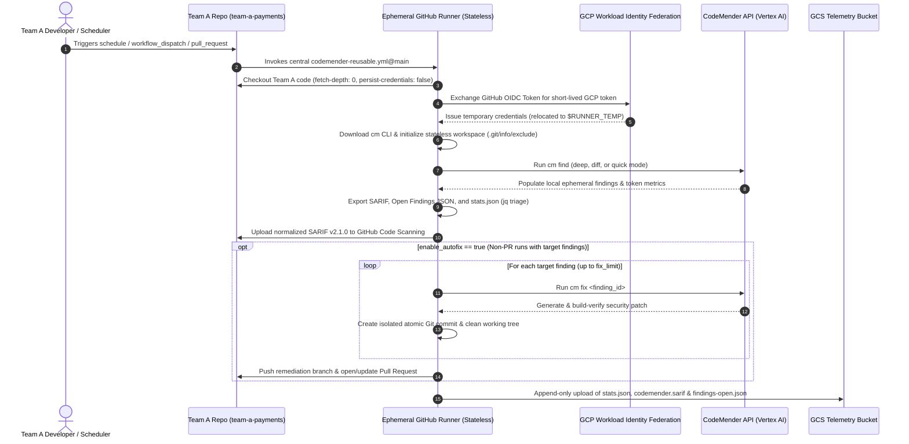

# 🛡️ Google Cloud CodeMender: Enterprise DevSecOps Reference Architecture & Team Onboarding Guide

**Centralized Governance with a Federated Per-Team Consumption Model (GitHub Actions + Google Cloud)**

---

## 1. Executive Summary

Organizations scaling AI-powered application security across dozens or hundreds of repositories face a common operational dilemma:
* **Copy-pasting complex CI/CD scripts** into every application repository creates maintenance drift, credential sprawl, and inconsistent security gates.
* **Synchronizing local CLI state databases (`state.db`)** across ephemeral CI runners introduces race conditions, state corruption on concurrent branches, and operational complexity.
* **Blocking developer Pull Requests** with long-running full-repository scans causes friction and slows delivery velocity.

This reference architecture solves these challenges using a **Hub-and-Spoke Reusable Workflow Model (`workflow_call`)** backed by **100% Stateless Ephemeral Runners**, **Keyless Organization-Wide OIDC Authentication (Workload Identity Federation)**, **Native SARIF v2.1.0 Vulnerability Lifecycle Management**, **Autonomous Remediation Pull Requests with Atomic Commits**, and **Append-Only FinOps Telemetry in Google Cloud Storage (GCS)**.

> [!IMPORTANT]
> **Key Outcome for Engineering & SecOps Teams:**
> Platform/SecOps teams maintain **one central workflow repository** ([`codemender-enterprise-workflows`](https://github.com/Cotomacio/codemender-enterprise-workflows)). Application teams (e.g., **Team A**) onboard in **under 5 minutes** by adding a 25-line caller YAML and a `.cmignore` file—with zero bash scripts, zero service account keys, and zero GCP IAM changes per repository.

---

## 2. High-Level Architecture & Execution Topology

### 2.1 Hub-and-Spoke Topology

The architecture separates **Central SecOps Governance (The Hub)** from **Application Team Consumption (The Spokes)** while keeping execution context isolated per application repository.



### 2.2 End-to-End Runtime Sequence

Even though the reusable workflow definition lives in the central **SecOps Hub Repository**, GitHub Actions executes the job **inside the calling team's repository context**:



---

## 3. Core Architectural Pillars

### Pillar 1: Central Governance, Local Execution Context
By leveraging GitHub Actions `on: workflow_call`, application teams never maintain CLI installation logic, `jq` triage filters, or `cm` flags. When the central SecOps team upgrades a model flag or workflow step in [`codemender-reusable.yml`](https://github.com/Cotomacio/codemender-enterprise-workflows/blob/main/.github/workflows/codemender-reusable.yml), every consuming repository inherits the improvement immediately. At runtime:
* `${{ github.repository }}` resolves to **Team A's repository** (`<org>/team-a-payments`).
* `${{ secrets.GITHUB_TOKEN }}` is scoped exclusively to **Team A's repository**.
* SARIF alerts land in **Team A's Security tab**, and remediation Pull Requests open directly in **Team A's repository**.

### Pillar 2: 100% Stateless Ephemeral Runners (No `state.db` Sync)
CodeMender stores local session data in `.cm_project/state.db` (SQLite). Synchronizing a single SQLite file back and forth to object storage across CI runs is an enterprise anti-pattern that causes lock contention and state overwrites when multiple branches or PRs run concurrently.

Instead, this architecture keeps runners **100% stateless**:
* **Vulnerability Lifecycle & Deduplication (For AppSec):** Handled natively by exporting **SARIF v2.1.0** (`cm report --format=sarif`) to **GitHub Code Scanning** (or an enterprise ASPM such as DefectDojo or Wiz). GitHub tracks finding fingerprints across commits and branches automatically.
* **Patch Delivery (For Developers):** In the same ephemeral runner session, `cm fix` consumes the finding UUIDs discovered moments earlier by `cm find` and delivers the patches as a standard **Git Pull Request**.

### Pillar 3: Organization-Wide Keyless OIDC Authentication (WIF)
Instead of generating static Service Account JSON keys or updating IAM policies every time a team creates a new repository, the Workload Identity Provider uses an organization-scoped attribute condition:
```text
assertion.repository_owner == '<YOUR_GITHUB_ORG>'
```
Any repository inside the GitHub Organization can authenticate keylessly via OIDC to the central `codemender-ci` Service Account out of the box.

### Pillar 4: Dual Operating Modes (Async Deep Audit vs. Sync PR Gate)
Application teams can adopt either or both workflows depending on their SDLC maturity:

| Capability | Mode A: Asynchronous Deep Audit & Auto-PR | Mode B: Synchronous PR Delta Gate |
| :--- | :--- | :--- |
| **Template File** | [`codemender-monthly-async.yml`](https://github.com/Cotomacio/codemender-enterprise-workflows/blob/main/examples/caller-repo/.github/workflows/codemender-monthly-async.yml) | [`codemender-pr-gate.yml`](https://github.com/Cotomacio/codemender-enterprise-workflows/blob/main/examples/caller-repo/.github/workflows/codemender-pr-gate.yml) |
| **Trigger** | `schedule` (e.g., 1st Monday/month) or manual `workflow_dispatch` | `pull_request` targeting `main` / `master` |
| **CodeMender Mode** | `deep` (`cm find --deep-workers=8`) | `diff` (`cm find --diff=origin/main --diff-workers=16`) |
| **Analysis Scope** | Full repository audit (excluding `.cmignore`) | Modified PR hunks + 1-hop callers/callees only |
| **Typical Duration** | 5–45 minutes (runs asynchronously in background) | **< 2 minutes** (fast developer feedback) |
| **Auto-Remediation (`cm fix`)** | **Enabled (`true`)** — opens PR with atomic commits | **Disabled (`false`)** — scan-only check |
| **CI Gate (`enforce_gate`)** | **Disabled (`false`)** — never breaks background cron runs | **Enabled (`true`)** — blocks PR merge if **new** `CRITICAL`/`HIGH` issues are introduced |

### Pillar 5: Developer-Friendly Atomic Commits
When `cm fix` remediates multiple vulnerabilities in a single run, lumping all changes into a single commit makes code review difficult. The workflow iterates through each target finding and creates **1 isolated Git commit per vulnerability**:
```text
fix(security): remediate OS Command Injection in Receipt Export Endpoint [CRITICAL]
CodeMender Finding ID: 5a216c18-8cfa-5432-a1e1-a37df4ed1ac5
```
Developers can inspect each fix independently, cherry-pick specific commits, or `git revert` an individual patch without discarding the rest of the Pull Request.

### Pillar 6: Append-Only FinOps & Audit Telemetry in GCS
Every workflow execution exports `stats.json` (token usage broken down by `find` and `fix`, cache hit rate, thinking ratio, and duration), `codemender.sarif`, and `findings-open.json` to an immutable, date-partitioned GCS path:
```text
gs://<BUCKET>/codemender-telemetry/<ORG>/<REPO>/<YYYY>/<MM>/<DD>/<TIMESTAMP>-<RUN_ID>/stats.json
```
Platform and FinOps teams can mount a BigQuery external table over this GCS prefix to track token consumption, cache efficiency, and remediation velocity across all business units.

---

## 4. Deep Dive: Step-by-Step Breakdown of the Central Reusable Workflow

Below is what happens inside [`.github/workflows/codemender-reusable.yml`](https://github.com/Cotomacio/codemender-enterprise-workflows/blob/main/.github/workflows/codemender-reusable.yml) during a run, including the production safeguards built into each phase:

### Step 1: Concurrency & Permissions ([L104-L115](https://github.com/Cotomacio/codemender-enterprise-workflows/blob/main/.github/workflows/codemender-reusable.yml#L104-L115))
```yaml
concurrency:
  group: codemender-${{ github.repository }}-${{ inputs.scan_mode }}-${{ github.ref_name }}
  cancel-in-progress: ${{ inputs.scan_mode == 'diff' }}
```
* **Smart Cancellation:** If a developer pushes multiple rapid commits to a Pull Request (`scan_mode == 'diff'`), `cancel-in-progress: true` aborts the superseded PR scan immediately to conserve Vertex AI tokens. Conversely, for `deep` scans (`cancel-in-progress: false`), active remediation runs are protected from mid-run cancellation.
* **Least-Privilege Token Permissions:** Grants `contents: write` (for pushing remediation branches), `pull-requests: write` (for opening PRs), `id-token: write` (for GCP WIF OIDC), and `security-events: write` (for SARIF Code Scanning upload).

### Step 2: Full-History Checkout Without Persisting Git Credentials ([L132-L136](https://github.com/Cotomacio/codemender-enterprise-workflows/blob/main/.github/workflows/codemender-reusable.yml#L132-L136))
```yaml
- name: Checkout Repository
  uses: actions/checkout@v4
  with:
    fetch-depth: 0
    persist-credentials: false
```
* `fetch-depth: 0` ensures full Git history is present so `cm find --diff=origin/main` can accurately compute diffs against the base branch.
* `persist-credentials: false` prevents `actions/checkout` from leaving the runner's `GITHUB_TOKEN` inside `.git/config` while analysis tools run.

### Step 3: Keyless WIF Authentication & Credential Relocation ([L150-L169](https://github.com/Cotomacio/codemender-enterprise-workflows/blob/main/.github/workflows/codemender-reusable.yml#L150-L169))
```yaml
- name: Authenticate to Google Cloud (WIF)
  uses: google-github-actions/auth@v2
  with:
    project_id: ${{ inputs.gcp_project_id }}
    workload_identity_provider: ${{ inputs.gcp_wif_provider }}
    service_account: ${{ inputs.gcp_sa_email }}
    audience: ${{ secrets.wif_audience }}

- name: Relocate WIF Credentials Outside Git Workspace
  run: |
    set -euo pipefail
    if [ -n "${GOOGLE_APPLICATION_CREDENTIALS:-}" ] && [ -f "$GOOGLE_APPLICATION_CREDENTIALS" ]; then
      cp "$GOOGLE_APPLICATION_CREDENTIALS" "$RUNNER_TEMP/gcp-creds.json"
      chmod 600 "$RUNNER_TEMP/gcp-creds.json"
      rm -f "$GOOGLE_APPLICATION_CREDENTIALS"
      echo "GOOGLE_APPLICATION_CREDENTIALS=$RUNNER_TEMP/gcp-creds.json" >> "$GITHUB_ENV"
      echo "CLOUDSDK_AUTH_CREDENTIAL_FILE_OVERRIDE=$RUNNER_TEMP/gcp-creds.json" >> "$GITHUB_ENV"
    fi
    rm -f "$HOME/.config/gcloud/application_default_credentials.json"
```

> [!WARNING]
> **Why Relocating WIF Credentials Is Mandatory:**
> By default, `google-github-actions/auth@v2` writes its temporary credential file (`gha-creds-<hash>.json`) directly into `$GITHUB_WORKSPACE` as an untracked file. Internally, CodeMender executes `git checkout HEAD -- . && git clean -fd` to reset the repository state before scanning and patching. If the credential file remains inside `$GITHUB_WORKSPACE`, `git clean -fd` deletes it mid-run, causing subsequent Vertex AI calls to fail with `No valid Application Default Credentials found`. Moving the file to `$RUNNER_TEMP/gcp-creds.json` (outside the Git working tree) and adding `gha-creds-*.json` to `.git/info/exclude` eliminates this failure mode completely.

### Step 4: Fast CodeMender CLI Installation ([L171-L189](https://github.com/Cotomacio/codemender-enterprise-workflows/blob/main/.github/workflows/codemender-reusable.yml#L171-L189))
* Downloads `cm-linux-amd64.zip` directly from the official `cmoc-prod` Artifact Registry via HTTPS `curl` (with `gcloud artifacts generic download` as fallback), extracts `cm` to `$RUNNER_TEMP/cmbin`, and adds it to `$GITHUB_PATH`.
* Using direct HTTPS download avoids requiring external IAM reader bindings for customer service accounts on the `cmoc-prod` project.

### Step 5: Stateless Workspace Initialization ([L191-L207](https://github.com/Cotomacio/codemender-enterprise-workflows/blob/main/.github/workflows/codemender-reusable.yml#L191-L207))
```bash
printf '%s\n' '.cm_project' '.exploit' 'gha-creds-*.json' >> .git/info/exclude
cm init
mkdir -p ~/.codemender
printf 'project_paths:\n  - "%s"\n' "$GITHUB_WORKSPACE" >> ~/.codemender/config.yaml
```
* Appends `.cm_project`, `.exploit`, and `gha-creds-*.json` to `.git/info/exclude` so Git ignores CodeMender's local working folders without modifying the application team's tracked `.gitignore`.
* Automatically configures a syntax verification build command (`python3 -m compileall -q .`) for Python repositories if no custom build command is set, allowing `cm fix` to validate its generated patches before committing.
* Runs `cm health --strict` to verify credentials, endpoint reachability, and project authorization before starting the scan.

### Step 6: Executing `cm find` ([L209-L233](https://github.com/Cotomacio/codemender-enterprise-workflows/blob/main/.github/workflows/codemender-reusable.yml#L209-L233))
* Passes `--fail-on=NONE --sandbox=false --yes --bypass-warning`:
  * `--sandbox=false` is required on GitHub-hosted runners (`ubuntu-24.04`) because hosted container/VM environments restrict unprivileged network namespace loopback `ioctl` calls; single-use ephemeral hosted VMs already provide job-level isolation.
  * `--fail-on=NONE` ensures `cm find` always exits `0` so downstream reporting, SARIF upload, and `cm fix` steps execute before the final `Evaluate Security Gate` step decides whether to fail the build.
* Dynamically appends `--deep-workers=8` (for `deep` mode), `--diff=origin/${BASE_BRANCH} --diff-workers=16` (for `diff` mode), or `--quick` (for `quick` mode), plus optional `--model` and `-c` (threat-model context) flags.

### Step 7 & 8: Triage (`jq`), Step Summary & SARIF Normalization ([L235-L295](https://github.com/Cotomacio/codemender-enterprise-workflows/blob/main/.github/workflows/codemender-reusable.yml#L235-L295))
* Exports `codemender.sarif`, `codemender-open.json`, and `codemender-stats.json`.
* **Legacy Finding Suppression:** In `--diff` mode, CodeMender may annotate untouched pre-existing issues with `[LEGACY / UNTOUCHED]`. The `jq` filter strips these out so PR gates only evaluate new/impacted risk, filters by `fix_severities` (e.g., `CRITICAL,HIGH`), sorts `CRITICAL` findings first, and caps the auto-fix queue at `fix_limit` (default `5`).
* **SARIF Path Normalization:** Rewrites absolute runner paths (`/home/runner/work/<repo>/<repo>/app.py`) in `codemender.sarif` into relative repository paths (`app.py`) and ensures `startLine >= 1` so `github/codeql-action/upload-sarif@v3` anchors alerts directly onto source lines in the GitHub UI.
* Publishes a clean Markdown summary table directly to `$GITHUB_STEP_SUMMARY`.

### Step 9 & 12: Autonomous Remediation (`cm fix`) & Pull Request Creation ([L297-L334](https://github.com/Cotomacio/codemender-enterprise-workflows/blob/main/.github/workflows/codemender-reusable.yml#L297-L334), [L361-L399](https://github.com/Cotomacio/codemender-enterprise-workflows/blob/main/.github/workflows/codemender-reusable.yml#L361-L399))
* Iterates over each queued finding in `findings.tsv`:
  1. Executes `cm fix "$FID" --sandbox=false --yes --bypass-warning`.
  2. Verifies `! git diff --quiet` to confirm a clean patch was applied to tracked files.
  3. Runs `git add -u` (staging only modified tracked files, never untracked artifacts) and creates an **atomic commit** referencing the finding title, severity, and UUID.
  4. Runs `git checkout HEAD -- . && git clean -fd` before the next iteration to guarantee a clean workspace.
* Uses `peter-evans/create-pull-request@v6` to push branch `codemender/auto-remediation-<base>` and open or update a structured Pull Request in the calling repository.

### Step 10, 11 & 13: FinOps Telemetry Export, Artifacts & Security Gate ([L336-L359](https://github.com/Cotomacio/codemender-enterprise-workflows/blob/main/.github/workflows/codemender-reusable.yml#L336-L359), [L401-L414](https://github.com/Cotomacio/codemender-enterprise-workflows/blob/main/.github/workflows/codemender-reusable.yml#L401-L414))
* Refreshes `cm stats --json` after `cm fix` finishes so token consumption from both discovery (`find`) and remediation (`fix`) is captured, then uploads `findings-open.json`, `codemender.sarif`, and `stats.json` to GCS and GitHub Workflow Artifacts.
* If `enforce_gate: true` (used in PR Delta Gates), fails the workflow (`exit 1`) if one or more target findings remain open.

---

## 5. Step-by-Step Implementation & Team Onboarding Guide

### Part A: One-Time Platform / SecOps Setup (Done Once per Organization)

#### 1. Run the GCP WIF & GCS Bootstrap Script
From an administrator workstation authenticated with `gcloud`, run [`scripts/setup-enterprise-wif-and-gcs.sh`](https://github.com/Cotomacio/codemender-enterprise-workflows/blob/main/scripts/setup-enterprise-wif-and-gcs.sh):

```bash
export PROJECT_ID="codemender-latam"          # Your allow-listed CodeMender GCP Project ID
export GITHUB_ORG="Cotomacio"                 # Your GitHub Organization or User name
export BUCKET_LOCATION="SOUTHAMERICA-EAST1"   # Regional location for FinOps telemetry bucket

./scripts/setup-enterprise-wif-and-gcs.sh
```

What this script automates in Google Cloud:
1. Enables `aiplatform.googleapis.com`, `iam.googleapis.com`, `iamcredentials.googleapis.com`, `cloudresourcemanager.googleapis.com`, `serviceusage.googleapis.com`, `sts.googleapis.com`, and `storage.googleapis.com`.
2. Creates the `codemender-ci@<PROJECT_ID>.iam.gserviceaccount.com` Service Account and grants `roles/aiplatform.user` and `roles/serviceusage.serviceUsageConsumer`.
3. Creates the GCS bucket `gs://<PROJECT_ID>-codemender-telemetry` with uniform bucket-level access and grants `roles/storage.objectUser` to `codemender-ci`.
4. Configures the Organization Policy `constraints/iam.workloadIdentityPoolProviders` (allowing `is:https://token.actions.githubusercontent.com`), creates the Workload Identity Pool (`github-org-pool`) and OIDC Provider (`codemender-oidc`), and binds `roles/iam.workloadIdentityUser` across all repositories owned by `GITHUB_ORG`.

#### 2. Configure the 4 GitHub Actions Variables
At the end of execution, the script outputs 4 values. Configure them once in **GitHub Organization Settings → Secrets and variables → Actions → Variables** (or Repository Variables if using a personal GitHub account):

| Variable Name | Example Value (`codemender-latam`) | Purpose |
| :--- | :--- | :--- |
| `GCP_QUOTA_PROJECT` | `codemender-latam` | GCP Project ID with CodeMender / Vertex AI enabled |
| `GCP_WIF_PROVIDER` | `projects/353807816023/locations/global/workloadIdentityPools/github-org-pool/providers/codemender-oidc` | Full WIF OIDC Provider resource path |
| `GCP_SA_EMAIL` | `codemender-ci@codemender-latam.iam.gserviceaccount.com` | Service Account impersonated by GitHub Actions runners |
| `GCP_TELEMETRY_BUCKET` | `codemender-latam-codemender-telemetry` | GCS bucket for append-only SARIF & FinOps token telemetry |

#### 3. Enable GitHub Actions Pull Request Creation Permission
In **GitHub Organization Settings (or Repository Settings) → Actions → General → Workflow permissions**, select:
* ✅ **Read and write permissions**
* ✅ **Allow GitHub Actions to create and approve pull requests**

---

### Part B: Per-Team Onboarding ("Team A" Consumption Model)

Once Part A is complete, onboarding any new repository (e.g., `team-a-payments`) takes **less than 5 minutes** and requires **zero GCP changes**.

#### Step 1: Add `.cmignore` to the Root of Team A's Repository
Copy [`examples/caller-repo/.cmignore`](https://github.com/Cotomacio/codemender-enterprise-workflows/blob/main/examples/caller-repo/.cmignore) to `.cmignore` at the root of Team A's repository. This excludes `node_modules/`, `venv/`, unit tests (`**/*_test.py`, `**/*Test.java`), generated protobuf/OpenAPI stubs, and static assets—reducing scan latency and Vertex AI token usage by 40–70%.

#### Step 2: Add the Asynchronous Audit & Auto-PR Workflow
Copy [`examples/caller-repo/.github/workflows/codemender-monthly-async.yml`](https://github.com/Cotomacio/codemender-enterprise-workflows/blob/main/examples/caller-repo/.github/workflows/codemender-monthly-async.yml) into Team A's `.github/workflows/codemender-monthly-async.yml`:

```yaml
name: CodeMender Monthly Security Audit & Auto-PR

on:
  schedule:
    - cron: '0 6 1-7 * 1'   # 1st Monday of every month at 03:00 BRT (06:00 UTC)
  workflow_dispatch:
    inputs:
      scan_mode:
        description: 'Scan mode (deep, diff, or quick)'
        default: 'deep'
        type: choice
        options: [deep, diff, quick]
      fix_limit:
        description: 'Max findings to auto-fix in a PR'
        default: '5'
        type: string

jobs:
  security-audit:
    uses: Cotomacio/codemender-enterprise-workflows/.github/workflows/codemender-reusable.yml@main
    with:
      gcp_project_id: ${{ vars.GCP_QUOTA_PROJECT }}
      gcp_wif_provider: ${{ vars.GCP_WIF_PROVIDER }}
      gcp_sa_email: ${{ vars.GCP_SA_EMAIL }}
      gcp_telemetry_bucket: ${{ vars.GCP_TELEMETRY_BUCKET }}
      scan_mode: ${{ inputs.scan_mode || 'deep' }}
      enable_autofix: true
      fix_severities: 'CRITICAL,HIGH'
      fix_limit: ${{ inputs.fix_limit || '5' }}
      enforce_gate: false
    secrets:
      wif_audience: ${{ secrets.WIF_AUDIENCE }}
```

#### Step 3: (Optional) Add the Fast PR Delta Gate Workflow
To block Pull Requests that introduce **new** `CRITICAL` or `HIGH` vulnerabilities into `main`, copy [`examples/caller-repo/.github/workflows/codemender-pr-gate.yml`](https://github.com/Cotomacio/codemender-enterprise-workflows/blob/main/examples/caller-repo/.github/workflows/codemender-pr-gate.yml) into `.github/workflows/codemender-pr-gate.yml`:

```yaml
name: CodeMender PR Delta Security Gate

on:
  pull_request:
    branches: [ "main", "master" ]
    paths-ignore:
      - '**.md'
      - '.gitignore'

jobs:
  pr-delta-gate:
    uses: Cotomacio/codemender-enterprise-workflows/.github/workflows/codemender-reusable.yml@main
    with:
      gcp_project_id: ${{ vars.GCP_QUOTA_PROJECT }}
      gcp_wif_provider: ${{ vars.GCP_WIF_PROVIDER }}
      gcp_sa_email: ${{ vars.GCP_SA_EMAIL }}
      gcp_telemetry_bucket: ${{ vars.GCP_TELEMETRY_BUCKET }}
      scan_mode: 'diff'
      enable_autofix: false
      fix_severities: 'CRITICAL,HIGH'
      enforce_gate: true
    secrets:
      wif_audience: ${{ secrets.WIF_AUDIENCE }}
```

---

### Part C: Complete Input Reference & Customization Recipes for Application Teams

Application teams can tailor the reusable workflow via the `with:` block without modifying the central workflow:

| Input Parameter | Type | Required | Default | Description |
| :--- | :--- | :---: | :---: | :--- |
| `gcp_project_id` | `string` | **Yes** | — | GCP Project ID (`${{ vars.GCP_QUOTA_PROJECT }}`) |
| `gcp_wif_provider` | `string` | **Yes** | — | Full WIF Provider resource name (`${{ vars.GCP_WIF_PROVIDER }}`) |
| `gcp_sa_email` | `string` | **Yes** | — | Service Account email (`${{ vars.GCP_SA_EMAIL }}`) |
| `gcp_telemetry_bucket` | `string` | No | `''` | GCS bucket name (without `gs://`) for FinOps & SARIF archiving |
| `scan_path` | `string` | No | `'.'` | Subdirectory to scan relative to repository root (ideal for monorepos) |
| `scan_mode` | `string` | No | `'deep'` | `'deep'` (full repo), `'diff'` (PR delta + 1-hop callers), or `'quick'` |
| `cm_model` | `string` | No | `''` | Optional Gemini model override (defaults to CLI default `gemini-3.8-flash`) |
| `cm_context` | `string` | No | `''` | Architectural or threat-model context passed to `cm find -c` |
| `enable_autofix` | `boolean` | No | `true` | Run `cm fix` on open findings and open an automated remediation PR |
| `fix_severities` | `string` | No | `'CRITICAL,HIGH'` | Comma-separated severities eligible for auto-remediation & gating |
| `fix_limit` | `string` | No | `'5'` | Maximum number of findings to auto-remediate in a single PR |
| `enforce_gate` | `boolean` | No | `false` | Fail the workflow job (`exit 1`) if open target findings remain |
| `upload_sarif` | `boolean` | No | `true` | Upload normalized SARIF v2.1.0 report to GitHub Code Scanning |
| `cm_version` | `string` | No | `'stable'` | CodeMender CLI version tag in Artifact Registry |

> [!TIP]
> **Customization Recipe — Passing Threat Model Context & Monorepo Subpaths:**
> If Team A owns a microservice inside a monorepo (`services/payments-api`) behind an API gateway, they can guide CodeMender's analysis agent to focus on high-impact sinks and reduce false positives:
> ```yaml
>     with:
>       gcp_project_id: ${{ vars.GCP_QUOTA_PROJECT }}
>       gcp_wif_provider: ${{ vars.GCP_WIF_PROVIDER }}
>       gcp_sa_email: ${{ vars.GCP_SA_EMAIL }}
>       scan_path: 'services/payments-api'
>       cm_context: 'PCI-DSS payment microservice behind mTLS gateway. Prioritize SQLi, command injection, and IDOR in transaction handlers.'
> ```

---

## 6. Verified End-to-End Customer Showcase (`team-a-payments`)

This architecture was validated end-to-end using the central repository [`Cotomacio/codemender-enterprise-workflows`](https://github.com/Cotomacio/codemender-enterprise-workflows) and the consumer repository [`Cotomacio/team-a-payments`](https://github.com/Cotomacio/team-a-payments) ([Workflow Run #40435451718](https://github.com/Cotomacio/team-a-payments/actions/runs/40435451718)).

### 6.1 Vulnerable Application Code Scanned (`app.py`)
Team A's payment service contained two high-impact vulnerabilities:
1. **`CWE-89` (HIGH — SQL Injection):** Unsanitized `merchant_ref` query parameter interpolated via `f-string` into `cursor.execute()` in `/api/v1/payments/lookup`.
2. **`CWE-78` (CRITICAL — OS Command Injection):** Unsanitized `invoice_id` JSON field interpolated into `subprocess.check_output(..., shell=True)` in `/api/v1/payments/receipt`.

### 6.2 Native SARIF v2.1.0 Alerts in GitHub Code Scanning
The workflow normalized and uploaded the SARIF report to GitHub Code Scanning, creating tracked security alerts anchored to the exact lines in `app.py`:
* **[Alert #1 — CRITICAL (`CWE-78`)](https://github.com/Cotomacio/team-a-payments/security/code-scanning/1):** *OS Command Injection in Receipt Export Endpoint* (`app.py#L37`)
* **[Alert #2 — HIGH (`CWE-89`)](https://github.com/Cotomacio/team-a-payments/security/code-scanning/2):** *SQL Injection in Payment Lookup Endpoint* (`app.py#L21`)

### 6.3 Autonomous Remediation Pull Request ([PR #1](https://github.com/Cotomacio/team-a-payments/pull/1))
In the same workflow execution, `cm fix` generated, build-verified, and committed patches for both findings on branch `codemender/auto-remediation-main`, opening **[Pull Request #1: 🛡️ CodeMender: Autonomous Security Remediation (2 fix(es))](https://github.com/Cotomacio/team-a-payments/pull/1)** with **two isolated atomic commits**:

1. **Commit `c8aa44a`:** `fix(security): remediate OS Command Injection in Receipt Export Endpoint [CRITICAL]` (`Finding ID: 5a216c18-8cfa-5432-a1e1-a37df4ed1ac5`)
2. **Commit `97dfde6`:** `fix(security): remediate SQL Injection in Payment Lookup Endpoint [HIGH]` (`Finding ID: af76a425-106a-5f1f-9ede-f2ce0a7c3092`)

#### Exact Diff Generated by CodeMender in PR #1:
```diff
diff --git a/app.py b/app.py
index 8d32377..cec8952 100644
--- a/app.py
+++ b/app.py
@@ -1,6 +1,7 @@
 """Team A — Payment Processing Microservice."""
 
 import os
+import re
 import sqlite3
 import subprocess
 from flask import Flask, jsonify, request
@@ -21,9 +22,8 @@ def lookup_payment():
     merchant_ref = request.args.get("merchant_ref", "")
     conn = get_db_connection()
     cursor = conn.cursor()
-    # Vulnerable to SQL Injection (CWE-89): direct string interpolation of user input
-    query = f"SELECT id, merchant_ref, amount_cents, status FROM payments WHERE merchant_ref = '{merchant_ref}'"
-    cursor.execute(query)
+    query = "SELECT id, merchant_ref, amount_cents, status FROM payments WHERE merchant_ref = ?"
+    cursor.execute(query, (merchant_ref,))
     row = cursor.fetchone()
     conn.close()
     if not row:
@@ -34,11 +34,24 @@ def lookup_receipt():
 @app.route("/api/v1/payments/receipt", methods=["POST"])
 def export_receipt():
     """Generate a receipt archive for the requested invoice ID."""
-    data = request.get_json(silent=True) or {}
+    data = request.get_json(silent=True)
+    if not isinstance(data, dict):
+        data = {}
     invoice_id = data.get("invoice_id", "default")
-    # Vulnerable to OS Command Injection (CWE-78): shell=True with unsanitized user input
-    cmd = f"tar -czf /tmp/receipt-{invoice_id}.tar.gz /var/ receipts/{invoice_id}.txt"
-    output = subprocess.check_output(cmd, shell=True, text=True)
+    if invoice_id is None:
+        invoice_id = "default"
+    if isinstance(invoice_id, int):
+        invoice_id = str(invoice_id)
+    if not isinstance(invoice_id, str) or not re.fullmatch(r"[a-zA-Z0-9_-]+", invoice_id):
+        return jsonify({"error": "Invalid invoice_id"}), 400
+    cmd = [
+        "tar",
+        "-czf",
+        f"/tmp/receipt-{invoice_id}.tar.gz",
+        "/var/",
+        f"receipts/{invoice_id}.txt",
+    ]
+    output = subprocess.check_output(cmd, text=True)
     return jsonify({"status": "exported", "details": output})
```

### 6.4 Append-Only FinOps Telemetry Exported to GCS
At the end of the run, the workflow archived the SARIF report, open findings JSON, and token telemetry to `gs://codemender-latam-codemender-telemetry/codemender-telemetry/Cotomacio/team-a-payments/2026/10/27/20261027T021200Z-40435451718/stats.json`:

```json
{
  "since": "7 days",
  "total_turns": 1,
  "total_polls": 1,
  "command_types": 1,
  "input_tokens": 26856,
  "output_tokens": 996,
  "cached_tokens": 7956,
  "thought_tokens": 6908,
  "tool_calls": 0,
  "total_tokens": 34760,
  "cache_hit_percent": 29.62,
  "think_ratio_percent": 87.40,
  "duration_seconds": 73.028,
  "duration_formatted": "01m 13s"
}
```
